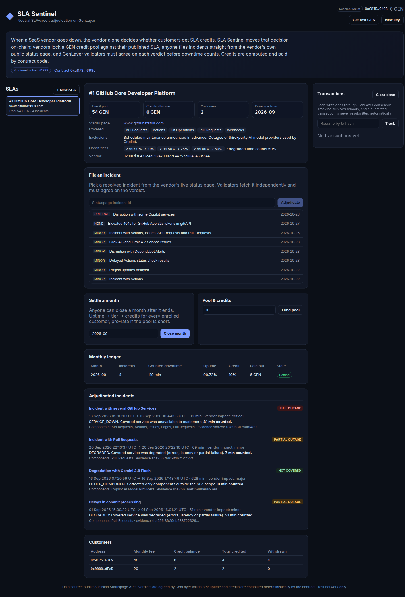

# SLA Sentinel

**Neutral SLA-credit adjudication for SaaS outages, on GenLayer.**

When a SaaS vendor goes down, the vendor alone decides whether the outage "counts" against its SLA and whether customers get service credits. Customers have to file tickets, argue with support, and accept the vendor's own uptime math. The party that pays the credit is also the judge.

SLA Sentinel moves that decision on-chain:

1. A vendor **publishes its SLA** to an Intelligent Contract: its public Statuspage host, the covered components, exclusions (in plain language), credit tiers and the weight of degraded time. It locks a **GEN credit pool** at the same time. There is no vendor withdrawal path.
2. The vendor **enrolls customers** with their monthly fee.
3. **Anyone** files an incident by its Statuspage ID. Every GenLayer validator fetches the incident **live from the vendor's own status page** (`https://<host>/api/v2/incidents/<id>.json`), and they must agree on what happened before anything is stored.
4. After a month ends, **anyone** closes it. The contract computes uptime, picks the credit tier and credits every customer from the pool (pro-rata if the pool runs short).
5. Customers **withdraw** their credits.

The vendor's own published data is the evidence, and the vendor can't overrule the verdict.

- Live app: _Vercel URL_ (see [Deploy](#deploy))
- Contract (Studionet, chain 61999): [`0xa87340B3519D73428c21c8eA1Fb9D0Cd752f668e`](https://explorer-studio.genlayer.com/address/0xa87340B3519D73428c21c8eA1Fb9D0Cd752f668e)



## Live demo on Studionet

SLA #1 on the live contract is **GitHub Core Developer Platform** on `www.githubstatus.com`. It covers Git Operations, API Requests, Pull Requests, Actions and Webhooks. Copilot's third-party model outages are excluded. Tiers: below 99.90 % uptime → 10 %, below 99.50 % → 25 %, below 99.00 % → 50 %. Degraded time counts 50 %. Pool: 60 GEN. Two customers are enrolled (40 and 20 GEN/month).

Four real September 2026 GitHub incidents, each adjudicated by validators reading githubstatus.com live:

| Incident | Vendor impact | Verdict | Counted |
|---|---|---|---|
| [`0rn90wk115q9`](https://www.githubstatus.com/incidents/0rn90wk115q9) Incident with several GitHub Services | critical | `FULL_OUTAGE / SERVICE_DOWN` | 81 min |
| [`f6yrxnz5f7bs`](https://www.githubstatus.com/incidents/f6yrxnz5f7bs) Incident with Pull Requests | minor | `PARTIAL_OUTAGE / DEGRADED` | 7 min |
| [`nlxnbqnkdzdl`](https://www.githubstatus.com/incidents/nlxnbqnkdzdl) Degradation with Gemini 3.8 Flash (Copilot AI Model Providers) | major | `NOT_COVERED / OTHER_COMPONENT` | 0 min |
| [`jk2dy5h9yp3m`](https://www.githubstatus.com/incidents/jk2dy5h9yp3m) Delays in commit processing | minor | `PARTIAL_OUTAGE / DEGRADED` | 31 min |

`close_month(1, "2026-09")` → 119 counted minutes → **99.72 % uptime** → 10 % credit → 4 GEN and 2 GEN credited. The pool is now 54 GEN, with 6 GEN allocated. The first customer then called `withdraw_credit` and received 4 GEN ([tx](https://explorer-studio.genlayer.com/tx/0xe17cc81e571c6ee9e71f2d0822874bc140efe749d9bffb25f3cf6f4e39f99fe2)).

Every transaction above reached `MAJORITY_AGREE` with leader execution `SUCCESS` and is `FINALIZED`.

## How a verdict is reached

`file_incident(sla_id, incident_id)` runs a leader/validator round (`gl.vm.run_nondet_unsafe`):

| Step | Who decides | How |
|---|---|---|
| Incident facts (title, impact, start/resolve times, scheduled flag, components, per-update component status timeline) | Status page | Every validator fetches the JSON itself. The facts must match the leader's **exactly**. |
| Does it count, and if not, why? | LLM, by consensus | Each validator independently picks one reason code: `SERVICE_DOWN`, `DEGRADED`, `MAINTENANCE`, `THIRD_PARTY`, `CUSTOMER_CAUSED`, `OTHER_COMPONENT`, `NO_CUSTOMER_IMPACT`, `INSUFFICIENT_EVIDENCE`. Exclusions are interpreted against the SLA's own text. |
| How many minutes count | Contract code | Deterministic: each interval between status updates is weighted by the worst status of a **covered** component (`major_outage` 100 %, `partial_outage`/`degraded_performance` = the SLA's degraded weight, else 0), clipped to the calendar month. |
| Hard overrides | Contract code | `scheduled_for` set → `EXCLUDED/MAINTENANCE`. No covered component affected → `NOT_COVERED/OTHER_COMPONENT`. Unresolved incidents, incidents before the coverage start and duplicates are rejected. |
| Credits | Contract code | `uptime_bp = (minutes_in_month − counted) × 10000 / minutes_in_month` → first tier whose threshold is above the uptime → `credit % × monthly fee` per customer. |

Validators don't have to agree on "full vs. degraded" when the status page publishes component statuses. That part is measured from the data, not judged. They only have to agree on whether the incident counts and, if it doesn't, which exclusion or coverage rule applies. This is the part that actually needs judgement, and it keeps consensus stable. When a status page publishes no component statuses, validators fall back to agreeing on `SERVICE_DOWN` vs. `DEGRADED` exactly.

Every stored incident keeps a SHA-256 `evidence_hash` of the agreed facts, so anyone can re-fetch the incident and check it.

Prompt-injection hardening: status-page text is fenced as data, and the model can only return one code from a fixed list. Anything else reverts with `[LLM_ERROR]` and stores nothing.

## Contract API (`contracts/sla_sentinel.py`)

| Method | Type | Notes |
|---|---|---|
| `create_sla(name, status_host, components_csv, exclusions, tiers, partial_weight_pct, coverage_start)` | write, payable | `tiers` like `9990:10,9950:25,9900:50` (uptime basis points : credit %). The sent value becomes the pool. |
| `fund_pool(sla_id)` | write, payable | Anyone can top up. |
| `enroll_customer(sla_id, customer, monthly_fee)` | write | Vendor only. Max 50 customers. |
| `file_incident(sla_id, incident_id)` | write, consensus | Live fetch + verdict, as described above. |
| `close_month(sla_id, "YYYY-MM")` | write | After the month ends. Credits customers. |
| `withdraw_credit(sla_id)` | write | Transfers the caller's credit balance in GEN. |
| `list_slas()`, `get_sla(id)`, `get_incidents(id)`, `get_months(id)`, `get_customers(id)`, `get_sla_count()` | view | |

Error prefixes: `[INVALID]`, `[NOT_FOUND]`, `[FORBIDDEN]`, `[LIMIT]`, `[DUPLICATE]`, `[NOT_READY]`, `[CLOSED]`, `[EXTERNAL]`, `[LLM_ERROR]`, `[EMPTY]`.

## Frontend (`frontend/`)

Vite + React + `genlayer-js`. It reads and writes the contract directly, with no backend.

- **Wallets**: a session wallet stored in the browser (with a Studionet faucet button), or MetaMask/any EIP-1193 wallet (adds/switches to chain 61999).
- **Publish SLA**: suggests component names fetched live from the chosen status page.
- **File incident**: lists resolved incidents from the vendor's live status page feed, inside the coverage window. Click one to adjudicate.
- **Ledger / incidents / customers**: verdicts, reason, counted minutes, evidence hash, monthly uptime and credits, customer balances, withdraw.
- **Transaction lifecycle**: each write is tracked through signing → submitted → pending → accepted → finalized, or rejected/failed. Failures show the consensus status and the contract's error message (execution result is read from the leader receipt, not just the consensus status). Tracking is saved in `localStorage` and resumes after a reload. You can also resume any tx by hash. A submitted tx is never resubmitted automatically.

```bash
cd frontend
npm ci
npm run dev        # http://localhost:5173
npm run build
```

`VITE_CONTRACT_ADDRESS` overrides the contract address (see `frontend/.env.example`). `VITE_RPC_URL` overrides the JSON-RPC endpoint (default `https://studio.genlayer.com/api`, called directly from the browser so the public per-IP rate limit applies per user).

## Tests

```bash
python3.12 -m venv .venv && . .venv/bin/activate
pip install genlayer-test genvm-linter
genvm-lint check contracts/sla_sentinel.py
pytest -q          # 23 direct-mode tests: mocked status pages + LLM, validator agreement/disagreement
```

Covered: SLA validation, vendor-only enrollment, payable pool, full/degraded/fallback minute counting, component-timeline measurement, validators that disagree on severity but agree on "counts", validators that disagree on exclusions, forged leader facts, maintenance and uncovered overrides, unresolved and pre-coverage incidents, HTTP errors, invalid model output, prompt-injection fencing, month settlement, pro-rata shortfall, withdrawals.

## Deploy

Contract:

```bash
cd frontend
DEPLOYER_PRIVATE_KEY=0x... node scripts/deploy.mjs
CONTRACT=0x... DEPLOYER_PRIVATE_KEY=0x... CUSTOMER_PRIVATE_KEY=0x... node scripts/demo.mjs   # optional: seeds the GitHub demo SLA
```

Frontend on Vercel: import this repo. `vercel.json` already builds `frontend/` and serves `frontend/dist`, so no settings are needed.

## Limits

- Runs on GenLayer Studionet with test GEN. It's not a legal SLA instrument.
- It trusts the vendor's public status page as the record of what happened. Outages the vendor never posts can't be claimed. A later version can accept third-party monitors as extra evidence.
- Supports Atlassian Statuspage-compatible APIs (GitHub, Atlassian, Cloudflare, OpenAI, Discord, and many more).
